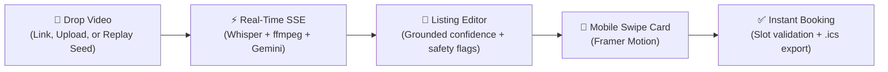

# Drop2List 🎬 → 📅

> **Turn short videos into ready-to-publish, bookable service listings.**  
> A proof-of-work prototype for [Xuman.AI](https://xuman.ai) (*"turn content into instant booking"*).

[](Makefile)
[](web/e2e/main-path.spec.ts)
[](evals/results.json)
[](web/)
[](api/)

---

## What is Drop2List?

Marketplaces live or die on provider supply onboarding. For tutors, coaches, and mentors (Guides), manually creating a listing—writing descriptions, determining pricing bands, choosing age categories, and defining formats—is high friction.

Yet almost every modern educator already demonstrates and describes their service in short-form video on **Instagram Reels, TikTok, or YouTube Shorts**. 

Drop2List collapses that 20-minute form-filling experience into a **30-second automated pipeline**:
1. **Paste a public link** or upload a clip.
2. Watch live pipeline stages stream in over **SSE** with speech transcription, scene detection, and reasoning progress.
3. Review an AI-generated listing with per-field confidence dots grounded in exact transcript quotes.
4. Catch youth-safety risks (off-platform contact, unverified credentials, minor meeting risks) with jump-to-timestamp evidence.
5. Test the customer experience immediately on a **mobile swipe-to-book card** with working mock instant booking.

---

## 30-Second User Journey



1. **Input**: Paste a public Reel, TikTok, or YouTube link, upload a video file, or click one of the pre-processed example chips for zero-quota replay.
2. **Live Pipeline**:
   - `fetching` → `transcribing` → `extracting_frames` → `analyzing` → `guardrails` → `done`.
3. **Editor & Safety Panel**:
   - Classification (Category, Age 3–18 range slider, 1:1 or Small Group, Virtual/In-Person/Hybrid mode).
   - Session duration, heuristic suggested price band, and weekly availability slots.
   - Dual-layer safety checks: high severity flags block publishing until resolved; clicking any flag jumps the source video directly to the cited evidence quote.
4. **Interactive Preview**:
   - Swipe right to book or swipe left to skip.
   - Select a 14-day date and time slot from the Guide's availability.
   - Immediate confirmation with downloadable calendar `.ics` file.

---

## Architecture & Engineering Highlights

```
apps/
  web/          Next.js 15 (App Router) + TypeScript + Tailwind CSS v4 + shadcn/ui
  api/          FastAPI (Python 3.12) — ingestion, Whisper, Gemini pipeline, guardrails
packages/
  schema/       listing.schema.json — single source of truth (codegens Pydantic & TS types)
evals/
  dataset.jsonl 26 hand-labeled public videos across 9 categories
  run_evals.py  evaluation runner scoring exact match, IoU, and guardrail precision/recall
  results.json  raw evaluation output consumed by the /evals UI
deploy/
  hf-space/     production Dockerfile + build script for Hugging Face Spaces (CPU tier)
```

### 1. Strict Free-Tier LLM Budget (~20 req/day per model)
- **Local Speech-to-Text**: Video audio is transcribed locally with `faster-whisper` (`small.en`, int8 quantized on CPU), consuming **0 model requests**.
- **Unified Extraction & Safety**: Youth-safety LLM classification is piggybacked into the single structured extraction pass (`api/prompts/extract_v5.md`).
- **Disk Caching**: `CachedLLM` stores responses keyed by prompt + schema + media hash (`api/data/llm_cache/`). Retries, repeated links, and eval reruns cost nothing.
- **Quota Rotation**: `LLM_MODELS` rotates through available Gemini flash variants on 429/503 quotas.

### 2. Pre-Processed Replay Seeds (`api/seed/`)
- Three real tutor videos (`math`, `ib-tutors`, `english`) are pre-seeded with saved frame JPEGs, SSE timeline events, and listings.
- Evaluators can click any example chip on the homepage to test the live streaming experience and full editor flow in ~3s without needing an API key or local ffmpeg.

### 3. Trust-First Youth Safety Guardrails
- **Regex Layer**: Scans transcripts and captions for phone numbers, WhatsApp, and social handles (`OFF_PLATFORM_CONTACT`).
- **Grounded LLM Layer**: Identifies unverified credentials, private meetings with minors without parent mention, and guaranteed outcomes. Unquoted flags are automatically dropped.
- **Dynamic Re-evaluation**: Form edits re-run guardrail rules live. Removing a phone number from the description immediately clears the flag.

---

## Evaluation Benchmark (26 Public Videos)

We evaluate the full pipeline against 26 hand-labeled public videos across all 9 Xuman service categories:

| Metric | Score | Note |
|---|---|---|
| **Category Accuracy** | **100%** (26/26) | Exact match across 9 standard marketplace categories |
| **Age Range Accuracy (IoU ≥ 0.5)** | **92.3%** (24/26) | Mean IoU: 0.82 |
| **Format (Group / 1:1) Accuracy** | **100%** (26/26) | Distinguishes small groups from individual sessions |
| **Format (Mode: Virtual/In-Person/Hybrid)** | **91.7%** (11/12) | Evaluated on rows with explicitly stated format modes |
| **Guardrail Recall** | **88.9%** (8/9) | Catches off-platform contact and risky claims |
| **Guardrail Precision** | **72.7%** (8/11) | Conservative bias: holds benign links for review |

> All numbers on the `/evals` page are loaded directly from `evals/results.json`. See `evals/notes.md` for error analysis.

---

## Getting Started

### Prerequisites
- Python 3.11+
- Node.js 20+ & `pnpm`
- `ffmpeg` installed on your system PATH

### Installation

```bash
# 1. Clone the repository
git clone https://github.com/rudrakshSoni-dev/drop-to-listing-agent-xumanai.git
cd drop-to-listing-agent-xumanai

# 2. Install dependencies (creates api/.venv and runs pnpm install)
make setup

# 3. Configure environment
cp api/.env.example api/.env
cp web/.env.example web/.env.local

# Optional: Add your GEMINI_API_KEY to api/.env.
# (If omitted, you can still test full functionality using the pre-seeded examples or recorded fixtures)
```

### Running Locally

```bash
# Start both API (:8000) and Web (:3000) concurrently
make dev
```
Visit [http://localhost:3000](http://localhost:3000) to open the app.

---

## Testing & Quality Assurance

```bash
# Run all automated tests (pytest + vitest + lint + mypy strict)
make test

# Run offline browser smoke test (Playwright: upload → live SSE → edit → book → confirm)
make e2e

# Run the 26-video evaluation suite (uses cached LLM responses)
make evals

# Regenerate TypeScript and Pydantic models from listing.schema.json
make schema
```

---

## What I'd Do With Real Marketplace Data

1. **Empirical Dynamic Pricing Engine**: Replace heuristic category bands with an empirical model trained on real transaction velocity, zip-code geography, seasonality, and Guide experience.
2. **Moderation Audit Log Fine-Tuning**: Fine-tune safety classifiers on real historical trust-and-safety dispute logs to distinguish benign resource URLs (e.g. syllabus links) from unauthorized off-platform contact.
3. **Curricula & Taxonomy Alignment**: Map extracted skills to standardized education frameworks (Common Core, IB, AP, USSF soccer levels) so parents can filter by grade milestones.
4. **Multi-Video Portfolio Clustering**: Aggregate multiple drops from the same Guide into a unified portfolio, detecting verified subject specializations and age distributions.
5. **Two-Way Real Calendar Integration**: Connect provider availability directly to Google and Apple Calendars via OAuth/CalDAV with automatic conflict resolution and timezone translation.

---

## License & Disclaimer

Built as a proof-of-work project for Xuman.AI. Not affiliated with or endorsed by Instagram, TikTok, YouTube, or Google.
